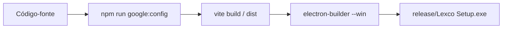
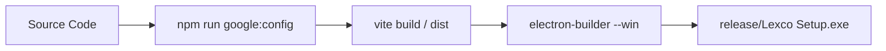

# Lexco — Gestão Jurídica Inteligente | Legal Management Desktop App

<div align="center">


-0078D6?style=for-the-badge&logo=windows&logoColor=white)

**[🇧🇷 Português](#-português)** &nbsp;|&nbsp; **[🇺🇸 English](#-english)**

</div>

---

<a name="-português"></a>
# 🇧🇷 Português

O **Lexco** é uma aplicação desktop de alta performance desenvolvida para escritórios de advocacia, departamentos jurídicos e profissionais do direito. Combinando uma interface moderna e intuitiva com armazenamento seguro local (*offline-first*), integrações com Google Workspace e consultas judiciais (DataJud e DJEN), o Lexco centraliza todo o fluxo de trabalho jurídico em um único lugar.

---

## 📑 Sumário

- [Visão Geral e Diferenciais](#-visão-geral-e-diferenciais)
- [Funcionalidades Principais](#-funcionalidades-principais)
- [Stack Tecnológica](#-stack-tecnológica)
- [Pré-requisitos](#-pré-requisitos)
- [Instalação e Ambiente de Desenvolvimento](#-instalação-e-ambiente-de-desenvolvimento)
- [📦 Tutorial: Como Gerar a Build do Executável (.exe)](#-tutorial-como-gerar-a-build-do-executável-exe)
  - [1. Preparação das Variáveis de Ambiente](#1-preparação-das-variáveis-de-ambiente)
  - [2. Geração do Ícone Oficial (Opcional)](#2-geração-do-ícone-oficial-opcional)
  - [3. Comandos de Build](#3-comandos-de-build)
  - [4. Localização dos Arquivos Gerados](#4-localização-dos-arquivos-gerados)
  - [5. Instalação e Teste do .exe](#5-instalação-e-teste-do-exe)
- [Resolução de Problemas (Troubleshooting)](#-resolução-de-problemas-troubleshooting)
- [Estrutura do Projeto](#-estrutura-do-projeto)
- [Testes e Qualidade](#-testes-e-qualidade)
- [Licença](#-licença)

---

## 💡 Visão Geral e Diferenciais

- **Arquitetura Local-First:** Os dados dos processos, prazos e clientes são persistidos localmente via IndexedDB (Dexie), garantindo velocidade instantânea, privacidade e funcionamento mesmo sem internet.
- **Protocolo Seguro Customizado (`app://lexco`):** O Electron serve os arquivos de produção sob um protocolo proprietário seguro, impedindo falhas de navegação do SPA e assegurando persistência estável.
- **Instalador Inteligente (NSIS):** Instalador otimizado com script dedicado (`build/installer.nsh`) para atualização em lote, limpeza de cache de ícones do Windows Explorer e preservação irrestrita do `%APPDATA%` do usuário entre atualizações.
- **Edições Sob Demanda:** Suporte nativo tanto para a versão padrão (**Lexco**) quanto para a edição institucional (**Lexco SPU**).

---

## ✨ Funcionalidades Principais

| Módulo | Descrição |
|---|---|
| 📁 **Gestão de Processos** | Cadastro completo, número CNJ, varas, instâncias, histórico de movimentações e notas. |
| ⏰ **Prazos & Audiências** | Monitoramento com contagem regressiva, alertas visuais de prioridade e status de cumprimento. |
| 👥 **Partes Interessadas** | Gerenciamento de clientes, requerentes, partes contrárias, advogados e testemunhas. |
| 📅 **Agenda Jurídica** | Calendário interativo de compromissos com filtros dinâmicos de período. |
| 📊 **Dashboard & Relatórios** | Painel analítico com gráficos financeiros, taxas de êxito e distribuição de demandas. |
| ☁️ **Google Drive & Docs** | Upload e anexo de peças, sincronização de arquivos e compartilhamento automatizado via OAuth IPC. |
| ⚖️ **DataJud & DJEN** | Módulo de consulta automática aos sistemas de dados do Judiciário e Diário Eletrônico. |

---

## 🛠️ Stack Tecnológica

- **Desktop Shell:** [Electron 45](https://www.electronjs.org/) & [electron-builder](https://www.electron.build/)
- **Frontend Core:** [React 18](https://react.dev/), [TypeScript 5](https://www.typescriptlang.org/), [Vite 5](https://vitejs.dev/)
- **UI & Estilização:** [Tailwind CSS](https://tailwindcss.com/), [shadcn/ui](https://ui.shadcn.com/) (Radix UI), [Lucide Icons](https://lucide.dev/)
- **Banco de Dados Local:** [Dexie.js](https://dexie.org/) (IndexedDB wrapper reativo)
- **Visualização de Dados:** [Recharts](https://recharts.org/)
- **Testes Automatizados:** [Vitest](https://vitest.dev/), [Playwright](https://playwright.dev/), [Testing Library](https://testing-library.com/)

---

## 💻 Pré-requisitos

Antes de iniciar, certifique-se de ter instalado no seu computador:

1. **Sistema Operacional:** Windows 10 ou Windows 11 (recomendado para a compilação do `.exe` com NSIS).
2. **Node.js:** Versão `18.x`, `20.x` ou superior ([Baixar Node.js](https://nodejs.org/)).
3. **Gerenciador de Pacotes:** `npm` (incluso no Node.js) ou `bun`.
4. **Git:** Para clonar o repositório ([Baixar Git](https://git-scm.com/)).

---

## 🚀 Instalação e Ambiente de Desenvolvimento

1. Clone o repositório:
   ```bash
   git clone https://github.com/seu-usuario/lexco.git
   cd lexco
   ```

2. Instale as dependências:
   ```bash
   npm install
   ```

3. Execute a aplicação em modo Desktop (Vite + Electron integrados com Hot-Reload):
   ```bash
   # Inicia a versão padrão do Lexco
   npm run electron:dev

   # Ou inicia a edição Lexco SPU
   npm run electron:dev:spu
   ```

> [!NOTE]
> Se quiser executar apenas o servidor web no navegador para testar telas sem os recursos de desktop nativo, execute `npm run dev`.

---

## 📦 Tutorial: Como Gerar a Build do Executável (.exe)

O processo de empacotamento do Lexco compila os scripts React/TypeScript via Vite, injeta as configurações seguras de integração e empacota o executável Windows (`.exe`) acompanhado de um instalador interativo NSIS.



### 1. Preparação das Variáveis de Ambiente

O aplicativo possui integração com APIs Google. Crie um arquivo `.env.local` na raiz do projeto caso queira ativar esses serviços na build final:

```ini
# .env.local (Opcional - caso utilize sincronização com o Google Drive)
CLIENT_ID="seu-google-client-id"
CLIENT_SECRET="seu-google-client-secret"
PROJECT_ID="seu-projeto-id"
```

> [!TIP]
> Se você não fornecer as chaves do Google, o aplicativo compilará normalmente, exibindo apenas um aviso no console informando que a sincronização em nuvem estará desativada.

### 2. Geração do Ícone Oficial (Opcional)

Se você alterou a imagem em `assets/icone.png`, regenere os ícones em formato `.ico` com todas as resoluções (16px até 256px) executando:

```bash
npm run icone
```
Isso atualizará o arquivo `public/favicon.ico` utilizado na barra de tarefas, atalhos da área de trabalho e cabeçalho do instalador.

### 3. Comandos de Build

Escolha o comando correspondente à versão que deseja compilar:

#### A. Gerar o Instalador do Lexco (Versão Completa)
```bash
npm run electron:build
```
*Executa `google:config` -> `vite build` -> `electron-builder --win`.*

#### B. Gerar o Instalador da Edição SPU (Lexco SPU)
```bash
npm run electron:build:spu
```
*Compila com a flag de ambiente institucional `VITE_EDICAO=spu` e define o identificador `br.com.lexco.spu`.*

#### C. Gerar Ambas as Edições de Uma Só Vez
```bash
npm run electron:build:todas
```

---

### 4. Localização dos Arquivos Gerados

Ao término do comando, os binários estarão disponíveis no diretório **`release/`**:

```
lexco/
├── release/
│   ├── Lexco Setup 1.1.0.exe           <-- 🎯 Instalador executável oficial para Windows
│   ├── Lexco Setup 1.1.0.exe.blockmap
│   ├── builder-debug.yml
│   ├── latest.yml
│   ├── win-unpacked/                   <-- Versão descompactada (portátil para testes rápidos)
│   │   ├── Lexco.exe
│   │   └── ...
│   └── spu/                            <-- (Se gerou a edição SPU)
│       ├── Lexco SPU Setup 1.1.0.exe   <-- 🎯 Instalador da Edição SPU
│       └── win-unpacked/
```

- **`Lexco Setup <versão>.exe`**: O arquivo distribuível para os clientes finais.
- **`win-unpacked/`**: Pasta contendo os arquivos já descompactados. Você pode clicar diretamente em `Lexco.exe` para testar o aplicativo sem precisar passar pelo instalador.

---

### 5. Instalação e Teste do .exe

1. Dê um duplo clique no arquivo `release/Lexco Setup 1.1.0.exe`.
2. O instalador NSIS oferece:
   - Escolha do diretório de instalação (`Program Files` ou personalizado).
   - Criação automática de atalhos na Área de Trabalho e no Menu Iniciar.
   - Atualização automática de atalhos e renovação do cache de ícones do Windows.
3. Seus dados cadastrados continuarão intactos caso reinstale ou atualize versões futuras.

---

## 🔧 Resolução de Problemas (Troubleshooting)

<details>
<summary><b>1. Erro ao baixar binários do Electron durante a build</b></summary>

Se o `electron-builder` falhar ao baixar os binários do Electron ou NSIS devido a instabilidades de rede, configure um mirror temporário no terminal:
```bash
$env:ELECTRON_MIRROR="https://npmmirror.com/mirrors/electron/"
$env:ELECTRON_BUILDER_BINARIES_MIRROR="https://npmmirror.com/mirrors/electron-builder-binaries/"
npm run electron:build
```
</details>

<details>
<summary><b>2. Erro de porta ocupada (Port 8080 already in use) em modo dev</b></summary>

O script de desenvolvimento aguarda a porta `8080`. Se ela estiver ocupada:
- Finalize processos Node órfãos via Gerenciador de Tarefas ou:
  ```powershell
  Stop-Process -Name node -Force
  ```
</details>

<details>
<summary><b>3. O Windows SmartScreen exibe tela azul "O Windows protegeu o seu computador"</b></summary>

Isso acontece porque o executável foi gerado sem um certificado digital de assinatura de código (Code Signing Certificate) comercial.
- Para testar localmente: clique em **"Mais informações"** e em seguida em **"Executar assim mesmo"**.
- Em ambientes corporativos: assine o binário com um certificado válido através das configurações `win.certificateFile` no `package.json`.
</details>

---

## 📂 Estrutura do Projeto

```
lexco/
├── assets/                  # Imagens e marcas em alta resolução (ex: icone.png)
├── build/                   # Scripts auxiliares do instalador NSIS (installer.nsh)
├── dist/                    # Build compilado do frontend web gerado pelo Vite
├── electron/                # Processo principal e APIs de backend Desktop
│   ├── consulta.cjs         # IPC para consultas jurídicas (DataJud / DJEN)
│   ├── google.cjs           # IPC para autenticação OAuth e Google Drive
│   ├── main.cjs             # Janela principal, protocolos e ciclo de vida
│   └── preload.cjs          # Bridge segura de comunicação (contextBridge)
├── public/                  # Favicons e manifestos estáticos
├── release/                 # Saída dos executáveis e instaladores .exe
├── scripts/                 # Scripts Node de automação e conversão de ícones
├── src/                     # Código-fonte React (SPA)
│   ├── components/          # Componentes visuais reutilizáveis (shadcn/ui)
│   ├── contexts/            # Contextos React (Tema, Autenticação, etc.)
│   ├── hooks/               # Custom hooks
│   ├── lib/                 # Utilitários e cliente Dexie (IndexedDB)
│   ├── pages/               # Telas (Processos, Prazos, Dashboard, etc.)
│   └── types/               # Tipagens TypeScript
├── package.json             # Dependências, scripts e configurações do electron-builder
└── vite.config.ts           # Configuração de build do Vite
```

---

## 🧪 Testes e Qualidade

- **Executar testes unitários:**
  ```bash
  npm run test
  ```
- **Executar testes em modo watch:**
  ```bash
  npm run test:watch
  ```
- **Verificar conformidade e linting:**
  ```bash
  npm run lint
  ```

---

## 📄 Licença

Proprietário. Todos os direitos reservados a **Lexco**.

---

<br />

<a name="-english"></a>
# 🇺🇸 English

**Lexco** is a high-performance desktop application engineered for law firms, legal departments, and solo practitioners. Combining a modern, accessible interface with local-first secure data persistence, Google Workspace synchronization, and court integration (DataJud and DJEN), Lexco provides an all-in-one workstation for legal management.

---

## 📑 Table of Contents

- [Overview & Highlights](#-overview--highlights)
- [Key Features](#-key-features)
- [Technology Stack](#-technology-stack)
- [System Requirements](#-system-requirements)
- [Getting Started & Development](#-getting-started--development)
- [📦 Tutorial: How to Build the Executable (.exe)](#-tutorial-how-to-build-the-executable-exe)
  - [1. Environment Configuration](#1-environment-configuration)
  - [2. Icon Generation (Optional)](#2-icon-generation-optional)
  - [3. Build Commands](#3-build-commands)
  - [4. Output Artifacts Directory](#4-output-artifacts-directory)
  - [5. Testing the Executable](#5-testing-the-executable)
- [Troubleshooting](#-troubleshooting)
- [Project Architecture](#-project-architecture)
- [Testing & Quality Assurance](#-testing--quality-assurance)
- [License](#-license)

---

## 💡 Overview & Highlights

- **Local-First Architecture:** Legal cases, deadlines, and client records are persisted locally via IndexedDB (Dexie), guaranteeing sub-millisecond response times, airtight data privacy, and full offline availability.
- **Custom Application Scheme (`app://lexco`):** Production web assets are served via a custom, privileged scheme within Electron, eliminating SPA routing pitfalls and keeping origin-bound databases permanent.
- **Optimized NSIS Windows Installer:** Features custom NSIS scripts (`build/installer.nsh`) for seamless in-place updates, automatic Windows Explorer icon cache invalidation, and preservation of user data located in `%APPDATA%`.
- **Multi-Edition Packaging:** Built-in targets for both the Standard Edition (**Lexco**) and institutional builds (**Lexco SPU**).

---

## ✨ Key Features

| Module | Description |
|---|---|
| 📁 **Case Management** | Full legal dossier tracking, CNJ numbering, courts, jurisdictions, procedural history, and notes. |
| ⏰ **Deadlines & Hearings** | Time-critical trackers with countdowns, priority coloring, and completion flags. |
| 👥 **Stakeholders & Parties** | Directory of clients, claimants, defendants, opposing counsels, and witnesses. |
| 📅 **Legal Calendar** | Interactive agenda with dynamic timeline filtering and appointment management. |
| 📊 **Dashboard & Metrics** | Real-time analytics on case volumes, win rates, and procedural stages. |
| ☁️ **Google Drive & Docs** | Document upload, document sharing, and cloud backups handled through IPC and OAuth 2.0. |
| ⚖️ **DataJud & DJEN** | Native lookup integration with Brazil's National Justice Database and Electronic Gazette. |

---

## 🛠️ Technology Stack

- **Desktop Framework:** [Electron 45](https://www.electronjs.org/) & [electron-builder](https://www.electron.build/)
- **Frontend Core:** [React 18](https://react.dev/), [TypeScript 5](https://www.typescriptlang.org/), [Vite 5](https://vitejs.dev/)
- **UI Components:** [Tailwind CSS](https://tailwindcss.com/), [shadcn/ui](https://ui.shadcn.com/) (Radix UI), [Lucide Icons](https://lucide.dev/)
- **Client-Side Database:** [Dexie.js](https://dexie.org/) (Reactive IndexedDB wrapper)
- **Data Visualization:** [Recharts](https://recharts.org/)
- **Automated Testing:** [Vitest](https://vitest.dev/), [Playwright](https://playwright.dev/), [Testing Library](https://testing-library.com/)

---

## 💻 System Requirements

Before you begin, ensure your development machine has:

1. **Operating System:** Windows 10 or 11 (required for native Windows `.exe` packaging).
2. **Node.js:** `v18.x`, `v20.x` or later ([Download Node.js](https://nodejs.org/)).
3. **Package Manager:** `npm` (bundled with Node.js) or `bun`.
4. **Git:** ([Download Git](https://git-scm.com/)).

---

## 🚀 Getting Started & Development

1. Clone the repository:
   ```bash
   git clone https://github.com/your-username/lexco.git
   cd lexco
   ```

2. Install dependencies:
   ```bash
   npm install
   ```

3. Launch the desktop development environment (Vite dev server + Electron with hot-reloading):
   ```bash
   # Standard Edition
   npm run electron:dev

   # SPU Edition
   npm run electron:dev:spu
   ```

> [!NOTE]
> If you want to preview the web interface inside a regular browser without Electron native features, run `npm run dev`.

---

## 📦 Tutorial: How to Build the Executable (.exe)

Building the Lexco binary compiles the frontend assets with Vite, embeds the runtime configurations, and runs `electron-builder` to output a signed NSIS installer for Windows.



### 1. Environment Configuration

If you plan to enable Google Drive or Google Workspace syncing in the compiled binary, configure `.env.local` in the project root:

```ini
# .env.local (Optional - required only for Google Drive integrations)
CLIENT_ID="your-google-client-id"
CLIENT_SECRET="your-google-client-secret"
PROJECT_ID="your-google-project-id"
```

> [!TIP]
> If omitted, the build will succeed without errors, and the application will gracefully disable Google Drive cloud syncing features.

### 2. Icon Generation (Optional)

If you modify or update the brand artwork at `assets/icone.png`, convert it into a multi-resolution `.ico` (16px to 256px) with:

```bash
npm run icone
```
This automatically updates `public/favicon.ico`, which is used across window bars, shortcut icons, and the NSIS installer header.

### 3. Build Commands

Select the appropriate build target:

#### A. Build the Standard Lexco Installer
```bash
npm run electron:build
```
*Executes `google:config` -> `vite build` -> `electron-builder --win`.*

#### B. Build the SPU Institutional Edition
```bash
npm run electron:build:spu
```
*Builds with `VITE_EDICAO=spu` and applies the `br.com.lexco.spu` target configuration.*

#### C. Build Both Editions Sequentially
```bash
npm run electron:build:todas
```

---

### 4. Output Artifacts Directory

Once compilation finishes, all output files are placed in the **`release/`** directory:

```
lexco/
├── release/
│   ├── Lexco Setup 1.1.0.exe           <-- 🎯 Official Windows NSIS Setup Installer
│   ├── Lexco Setup 1.1.0.exe.blockmap
│   ├── builder-debug.yml
│   ├── latest.yml
│   ├── win-unpacked/                   <-- Unpacked directory (ideal for immediate testing)
│   │   ├── Lexco.exe
│   │   └── ...
│   └── spu/                            <-- (If SPU edition was built)
│       ├── Lexco SPU Setup 1.1.0.exe   <-- 🎯 SPU Setup Installer
│       └── win-unpacked/
```

- **`Lexco Setup <version>.exe`**: The installer intended for distribution to end-users.
- **`win-unpacked/`**: Portable, unpacked binary folder. You can directly run `Lexco.exe` to test changes without going through the installation wizard.

---

### 5. Testing the Executable

1. Double click `release/Lexco Setup 1.1.0.exe`.
2. Follow the NSIS setup wizard:
   - Select the target installation directory.
   - Choose whether to create Desktop and Start Menu shortcuts.
3. The custom installer script flushes the Windows Explorer icon cache so the high-resolution app icon appears immediately.
4. Launch the application from your Desktop or Start Menu. Existing databases in `%APPDATA%` will be loaded smoothly.

---

## 🔧 Troubleshooting

<details>
<summary><b>1. Electron download timeout during build</b></summary>

If your network connection interrupts downloading Electron or NSIS binaries during the build, specify an alternative mirror:
```bash
$env:ELECTRON_MIRROR="https://npmmirror.com/mirrors/electron/"
$env:ELECTRON_BUILDER_BINARIES_MIRROR="https://npmmirror.com/mirrors/electron-builder-binaries/"
npm run electron:build
```
</details>

<details>
<summary><b>2. Port conflict (Port 8080 already in use) in development mode</b></summary>

If port 8080 is retained by a zombie process, terminate orphaned Node tasks via PowerShell:
```powershell
Stop-Process -Name node -Force
```
</details>

<details>
<summary><b>3. Windows SmartScreen warning ("Windows protected your PC")</b></summary>

This is standard behavior on Windows for newly compiled binaries lacking a commercial Code Signing Certificate.
- To run locally: click **"More info"** and then select **"Run anyway"**.
- For enterprise distribution: supply a code signing certificate via `win.certificateFile` in `package.json`.
</details>

---

## 📂 Project Architecture

```
lexco/
├── assets/                  # High-resolution logos and graphic assets (e.g. icone.png)
├── build/                   # NSIS packaging script extensions (installer.nsh)
├── dist/                    # Compiled web client output produced by Vite
├── electron/                # Main process runtime and desktop IPC handlers
│   ├── consulta.cjs         # Judicial query handlers (DataJud / DJEN)
│   ├── google.cjs           # Google OAuth 2.0 & Google Drive IPC
│   ├── main.cjs             # Window lifecycle and protocol handlers
│   └── preload.cjs          # Context bridge script exposing desktop APIs
├── public/                  # Static assets and icons
├── release/                 # Output directory for .exe installers and builds
├── scripts/                 # Node maintenance utilities and icon converters
├── src/                     # React frontend source code (SPA)
│   ├── components/          # Reusable UI component library (shadcn/ui)
│   ├── contexts/            # Global context providers
│   ├── hooks/               # Custom React hooks
│   ├── lib/                 # Utilities and Dexie (IndexedDB) database
│   ├── pages/               # Application views (Cases, Agenda, etc.)
│   └── types/               # TypeScript type definitions
├── package.json             # Build configurations, electron-builder settings & scripts
└── vite.config.ts           # Vite build tool configuration
```

---

## 🧪 Testing & Quality Assurance

- **Run unit test suite:**
  ```bash
  npm run test
  ```
- **Run tests in interactive watch mode:**
  ```bash
  npm run test:watch
  ```
- **Lint code:**
  ```bash
  npm run lint
  ```

---

## 📄 License

Proprietary. All rights reserved by **Lexco**.
